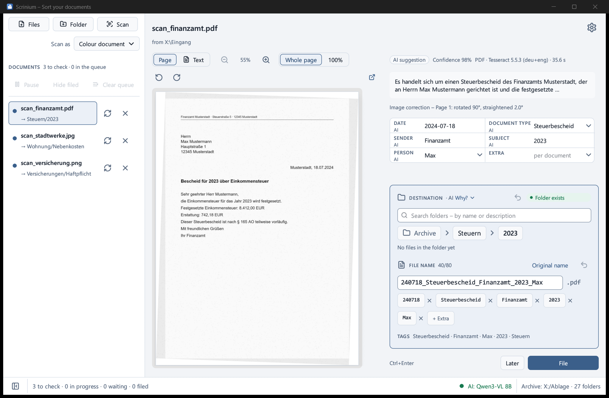

# Scrinium

**Sort documents with local AI – drop in a scan, check the suggestion, file it.**

Scrinium (Latin *scrinium*, “writing case, archive”) reads letters, invoices and official notices, suggests a file name and a folder in your existing archive, and files the document there once you confirm. The AI runs inside the program; nothing leaves your computer.

**Document language:** the interface speaks English, German, French, Spanish and Italian, but the detection without AI (dates, document types, senders, legal forms) is built for German-language documents. For documents in other languages, good suggestions depend on the AI.

  

Example with made-up test scans.

## What it does

- **Scans, PDFs, images, Office files and e-mails** – drag them in, choose them, or scan straight from the scanner; scans are straightened and saved as a searchable PDF.
- **Built-in AI** – on the graphics card (AMD, NVIDIA, Intel) or the processor; one click downloads the right model.
- **Your folders** – the AI chooses only among existing folders, guided by short descriptions. Keywords settle clear cases without the AI.
- **File names by template** – e.g. `260925_Steuerbescheid_Finanzamt_2025.pdf`.
- **Check before filing** – you can change every value and undo the last filing.
- **Five interface languages** – English, German, French, Spanish, Italian.

## Install

Download from [Releases](https://github.com/fly2nbc-oss/Scrinium/releases):

| File | For |
|---|---|
| `scrinium_<version>_x64-setup.exe` | Windows 10/11 – installer, no admin rights needed |
| `scrinium_<version>_x64-portable.zip` | Windows 10/11 without installing – unpack and start `Scrinium\scrinium.exe` |
| `scrinium_<version>_x86_64.AppImage` | Linux (Ubuntu 24.04, Debian 13, Fedora 40 or newer) |
| `scrinium_<version>_amd64.deb` | Ubuntu 24.04+ / Debian 13+ – `sudo apt install ./scrinium_<version>_amd64.deb` |
| `scrinium_<version>_linux_x86_64.tar.gz` | Linux x86-64, the program file only |

The Windows installer is not signed yet: SmartScreen asks once (*More info* → *Run anyway*).

On first start, open the settings with the gear at the top right: choose your archive folder under *Archive* and download the model under *AI › Model and graphics card*.

## How it works

1. Drag documents into the window, click *Files* or *Folder*, or click *Scan*.
2. Check the suggestion on the right: date, type, sender, subject, target folder, file name. If a page is upside down, rotate it above the preview.
3. **File** (`Ctrl+Enter`) – Scrinium renames the file and moves it.

## Privacy

Documents, texts and file names stay on your computer; there is no telemetry. Scrinium goes online only for the update check (only if you agree, once a day at GitHub) and for one-time downloads: the AI model when you click *Download*, PDFium and the language data for text recognition. Only if you set up your own server (LM Studio, Ollama) instead of the built-in AI does Scrinium send text and, if enabled, the page image there.

## More

- File names: [`docs/filenames.md`](./docs/filenames.md) · Folder choice and rules: [`docs/archive.md`](./docs/archive.md) · AI and OCR: [`docs/ai.md`](./docs/ai.md) · Configuration and command line: [`docs/configuration.md`](./docs/configuration.md)
- Building and contributing: [`CONTRIBUTING.md`](./CONTRIBUTING.md) · Changes: [`CHANGELOG.md`](./CHANGELOG.md) · Security: [`SECURITY.md`](./SECURITY.md)
- License: Apache 2.0 ([`LICENSE`](./LICENSE)), third-party components in [`THIRD_PARTY.md`](./THIRD_PARTY.md)
